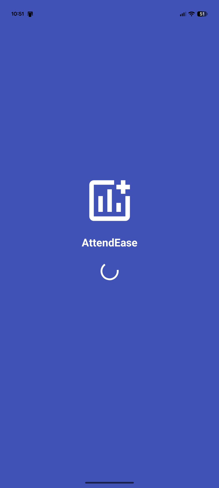
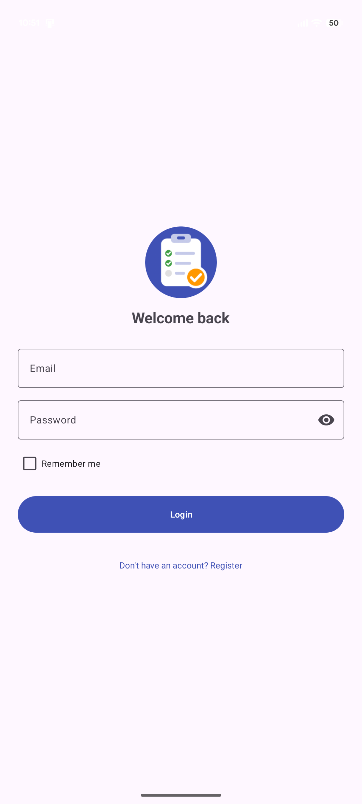
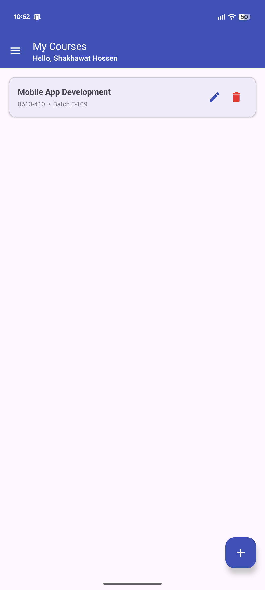
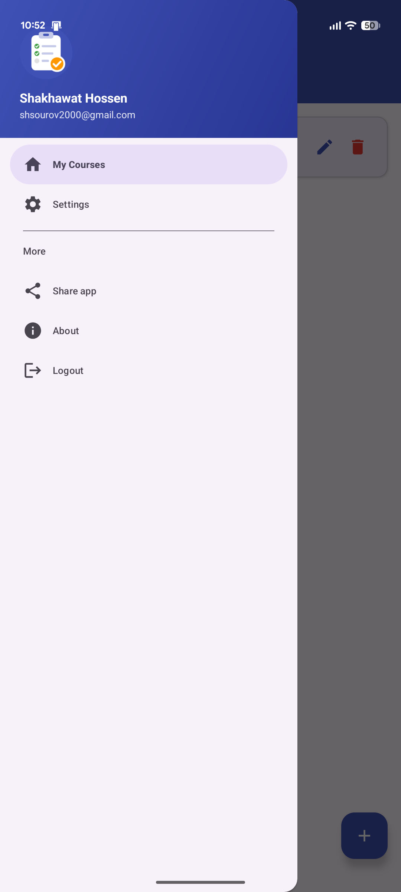
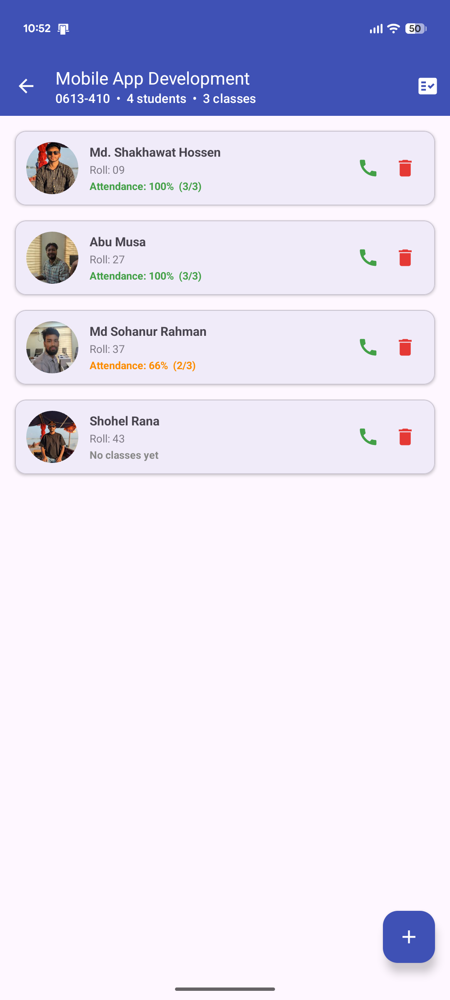
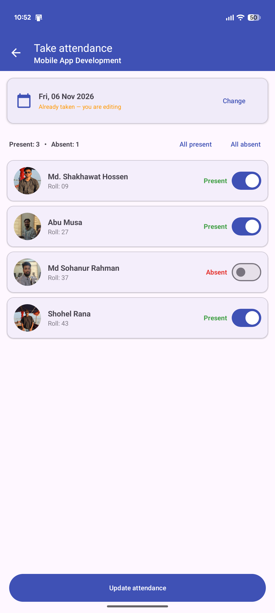
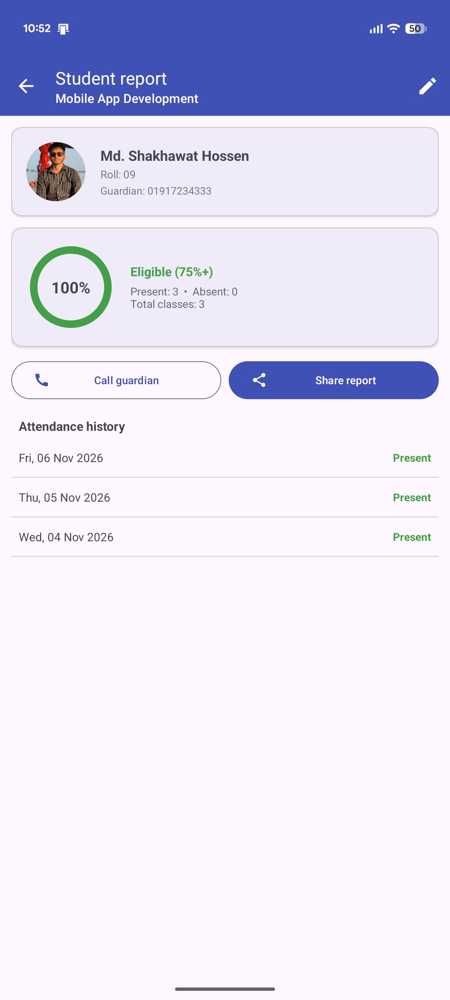
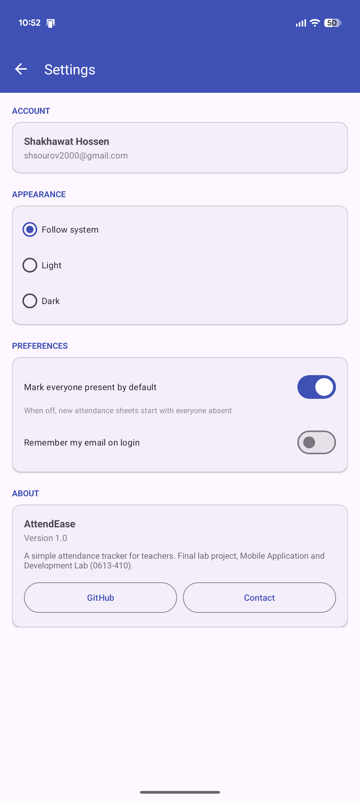

<p align="center">
  
</p>

<h1 align="center">AttendEase</h1>

<p align="center">
  A simple, real-time student attendance tracker for teachers.<br/>
  Built with <b>Java + XML</b> in Android Studio and <b>Firebase</b>.
</p>

<p align="center">
  <a href="https://github.com/Shakhawat15/AttendEase/releases/latest"><b>⬇ Download the APK (v1.0)</b></a>
</p>

---

## 👤 Author

|             |                                                   |
| ----------- | ------------------------------------------------- |
| **Name**    | Md Shakhawat Hossen                               |
| **Roll**    | 09                                                |
| **Batch**   | E-109                                             |
| **Course**  | Mobile Application and Development Lab (0613-410) |
| **Project** | Final Lab Project                                 |

---

## 📌 The problem

Many teachers still take attendance on paper. Registers get lost, counting each student's percentage at the end of the semester takes hours, and parents only hear about poor attendance when it is too late.

## 🎯 The goal

AttendEase lets a teacher manage courses and students on their phone, take attendance for a whole class in seconds, see every student's attendance percentage instantly, and contact or share a report with guardians, with all data synced to the cloud in real time.

---

## ✨ Features

### Required features

| #   | Feature                         | How it is used in AttendEase                                                                                                                                       |
| --- | ------------------------------- | ------------------------------------------------------------------------------------------------------------------------------------------------------------------ |
| 1   | 5+ screens with navigation      | Splash, Login, Register, Home, Course Detail, Add/Edit Student, Take Attendance, Student Report, Settings. Data is passed with `putExtra()`                        |
| 2   | Layouts and basic views         | `ConstraintLayout`, `LinearLayout`, `CoordinatorLayout`, `TextView`, `ImageView`, `MaterialButton`, `MaterialCardView`                                             |
| 3   | Input validation                | `TextInputLayout.setError()` for empty fields, invalid email, short password, mismatched passwords, invalid phone numbers (01XXXXXXXXX) and duplicate roll numbers |
| 4   | Model classes                   | `User`, `Course`, `Student`, `AttendanceRecord`                                                                                                                    |
| 5   | Scrolling lists                 | `RecyclerView` + `Adapter` + `ViewHolder` for courses, students, attendance sheet and history                                                                      |
| 6   | CRUD with dialog and FAB        | Add/edit/delete courses (dialog) and students (screen); `FloatingActionButton` to add; `AlertDialog` to confirm deletes; Snackbar **Undo**                         |
| 7   | Firebase Authentication         | Register, login, logout and stay logged in (checked on the Splash screen)                                                                                          |
| 8   | Firebase Realtime Database      | All data stored in the cloud; lists and percentages update live with `ValueEventListener`                                                                          |
| 9   | SharedPreferences               | Remember me (email), theme (Light/Dark/System), default attendance status                                                                                          |
| 10  | Camera / Gallery                | Take or pick a student photo (`TakePicturePreview`, `GetContent`)                                                                                                  |
| 11  | Implicit intents                | `ACTION_DIAL` (call guardian), `ACTION_SEND` (share report and app), `ACTION_VIEW` (GitHub link), `ACTION_SENDTO` (email developer)                                |
| ✔   | App name, icon, theme, messages | Custom adaptive icon, Material 3 theme, Snackbar and Toast messages                                                                                                |

### Bonus features

- 🧭 **Navigation drawer** with user header (name, email) on the Home screen
- 🌙 **Dark mode** (Light / Dark / Follow system), saved across launches
- 📊 **Attendance percentage** with colour coding (≥ 75 % eligible) and circular progress
- 📅 **Material date picker** (no future dates) and editing of past attendance
- 🔒 **Firebase security rules**: each teacher can only access their own data

---

## 📱 Screenshots

| Splash                                               | Login                                               | Home                                               | Drawer                                               |
| ---------------------------------------------------- | --------------------------------------------------- | -------------------------------------------------- | ---------------------------------------------------- |
|  |  |  |  |

| Students                                               | Take attendance                                          | Student report                                       | Settings                                               |
| ------------------------------------------------------ | -------------------------------------------------------- | ---------------------------------------------------- | ------------------------------------------------------ |
|  |  |  |  |

---

## 🛠 Tech stack

- **Language:** Java
- **UI:** XML layouts, Material Components (Material 3)
- **Backend:** Firebase Authentication (Email/Password), Firebase Realtime Database
- **Min SDK:** 24 (Android 7.0)
- **IDE:** Android Studio

---

## 🗄 Firebase database structure

```
users/
  {uid}: { uid, name, email }

courses/
  {uid}/
    {courseId}: { id, name, code, batch }

students/
  {courseId}/
    {studentId}: { id, name, roll, phone, guardianPhone, photo (Base64) }

attendance/
  {courseId}/
    {yyyy-MM-dd}/
      {studentId}: true | false
```

Security rules are in [`database.rules.json`](database.rules.json).

---

## ▶️ How to run

### Option 1: Install the APK

1. Download `AttendEase-v1.0.apk` from the [latest release](https://github.com/Shakhawat15/AttendEase/releases/latest).
2. Open it on an Android phone (Android 7.0+) and allow **Install unknown apps** if asked.
3. Register a new account and start adding courses.

### Option 2: Build from source

1. Clone the repository:
   ```bash
   git clone https://github.com/Shakhawat15/AttendEase.git
   ```
2. Open the folder in **Android Studio** and wait for Gradle sync to finish.
3. Connect a phone (USB debugging on) or start an emulator.
4. Click **Run ▶**.

> The project already contains `google-services.json`, so it connects to the existing Firebase project. To use your own Firebase project instead, replace `app/google-services.json`, enable **Email/Password** sign-in and create a **Realtime Database**, then publish the rules from `database.rules.json`.

---

## 📂 Project structure

```
app/src/main/java/com/example/attendease/
├── AttendEaseApp.java          # Applies saved theme at startup
├── SplashActivity.java         # Auto-login check
├── LoginActivity.java          # Login + remember me
├── RegisterActivity.java       # Registration
├── HomeActivity.java           # Courses list + navigation drawer
├── CourseDetailActivity.java   # Students list + attendance %
├── AddEditStudentActivity.java # Add/edit student + photo
├── TakeAttendanceActivity.java # Mark present/absent by date
├── StudentReportActivity.java  # History, call guardian, share report
├── SettingsActivity.java       # Theme, preferences, about
├── CourseAdapter / StudentAdapter / AttendanceAdapter / HistoryAdapter
├── User / Course / Student / AttendanceRecord   # Model classes
└── FirebaseHelper / ImageUtils / DateUtils / Prefs   # Helpers
```

---

## 📄 License

This project was made for academic purposes as part of the Mobile Application and Development Lab course.
